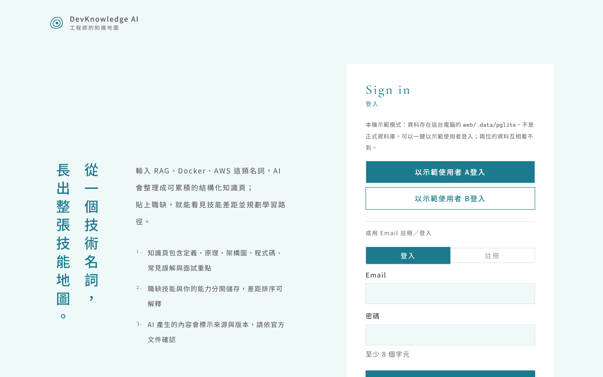
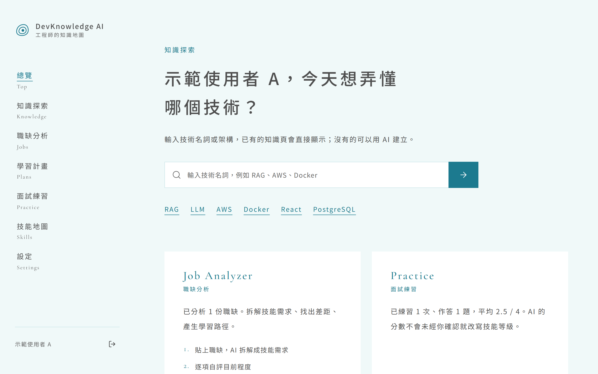
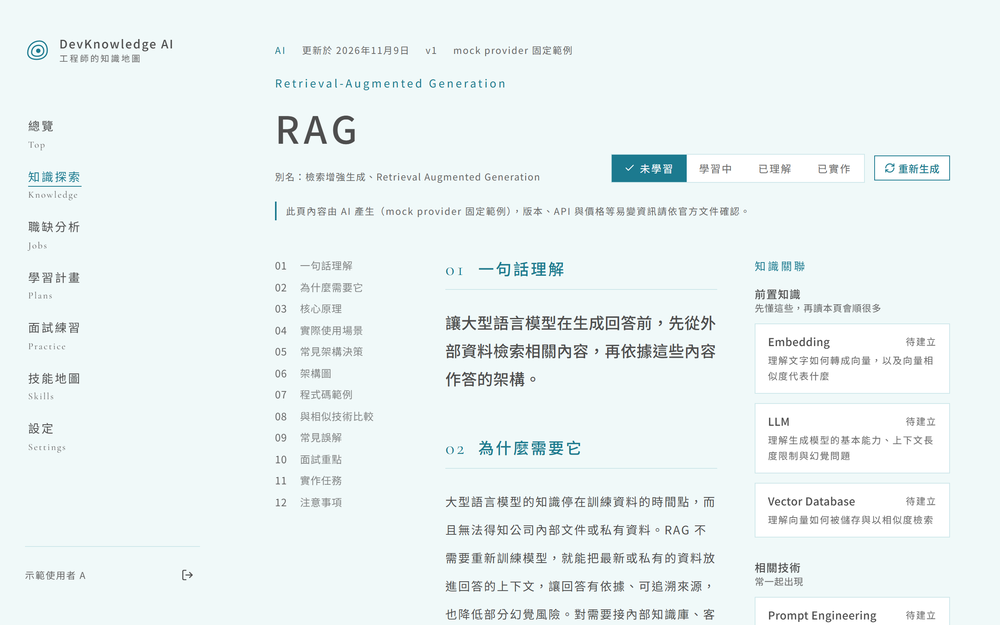
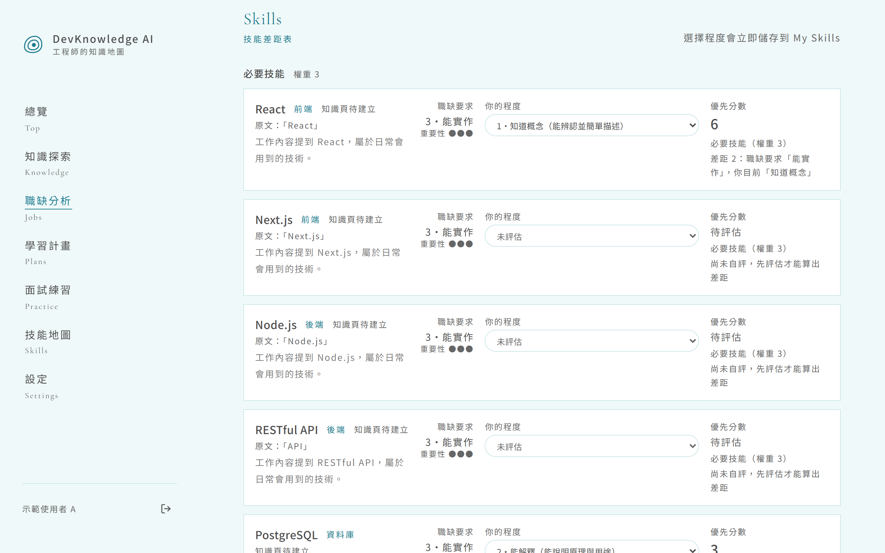
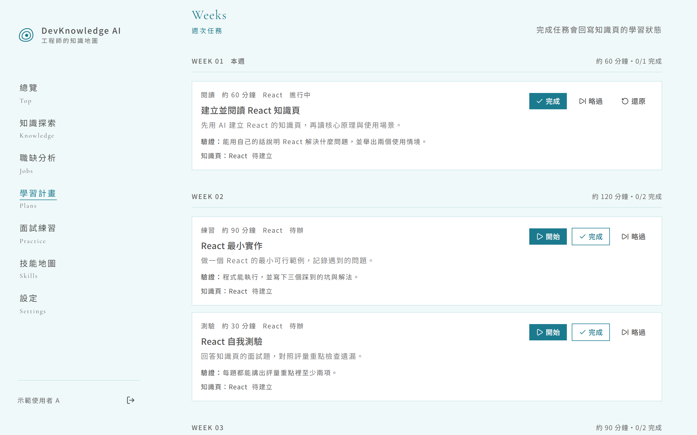
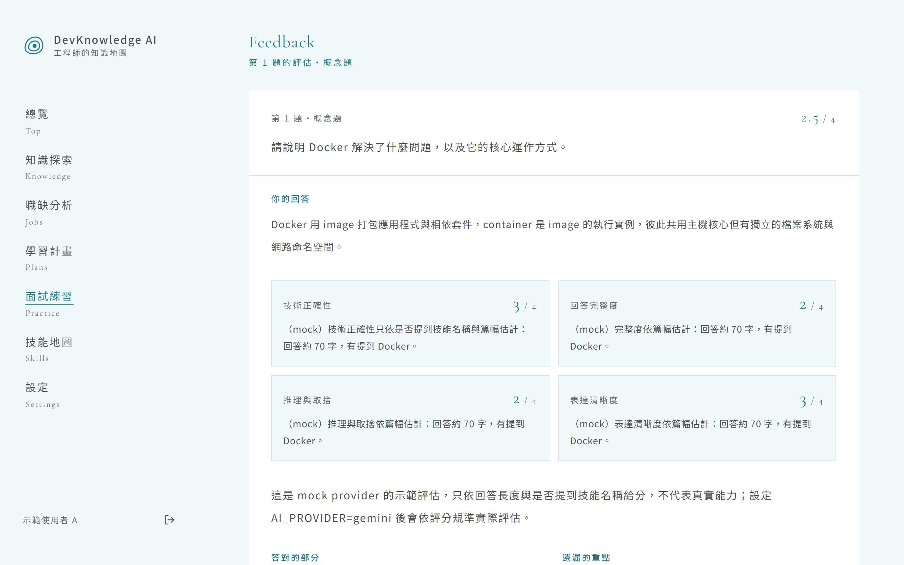

<p align="center">
  
</p>

<h1 align="center">DevKnowledge AI</h1>
<p align="center">工程師的知識地圖</p>

從技術名詞建立知識地圖，從真實職缺補足工程師技能：搜尋一個技術名詞就得到一頁結構化的知識（定義、原理、架構圖、程式碼、比較、常見誤解、面試重點、實作任務）；貼上一份職缺，AI 拆成標準化技能需求，逐項自評後看見差距與優先順序，再產生每週學習計畫、一次一題的面試練習，進度回寫到自己的技能地圖。

線上版本：https://devknowledge-ai.vercel.app

## 畫面

畫面取自本機示範模式（內嵌資料庫、mock AI 的固定範例內容），用 `npm run screenshots` 自動產生。

| | |
|---|---|
| **登入** 直書標語與一鍵示範登入  | **總覽** 搜尋技術名詞，看本週學習與練習狀況  |
| **知識頁** 十二個段落的結構化內容，右側是前置／相關知識  | **職缺分析** 技能需求、自評程度、可解釋的差距與優先分數  |
| **學習計畫** 依差距排出週次任務，完成會回寫知識進度  | **面試練習** 一次一題，四個維度評估，自己確認程度才寫進技能  |

## 這個 repo 裡有什麼

| 路徑 | 內容 |
|------|------|
| `web/` | Next.js 應用程式本體。**安裝、環境變數、指令、架構與設計決策都在 [`web/README.md`](web/README.md)** |
| `docs/brand-guidelines.md` | 品牌規範：圖示、色彩、字體、版面、語氣 |
| `docs/brand/` | 品牌圖示向量檔（青藍實色、繼承顏色、方塊版） |
| `docs/screenshots/` | README 用的畫面截圖（`cd web && npm run screenshots` 重新產生） |
| `DevKnowledge_AI_MVP_Spec.md` | 產品規格（MVP） |

## 快速開始

```bash
cd web
npm install
npm run dev
```

不需要資料庫或 API 金鑰：沒設 `DATABASE_URL` 時用內嵌的 PGlite，AI 用 mock provider 回固定範例，登入頁有示範使用者按鈕。接上 Gemini、Neon、Resend 的步驟見 [`web/README.md`](web/README.md)。

## 技術

Next.js 16（App Router）、TypeScript、Tailwind 4、shadcn/ui、Drizzle ORM、PostgreSQL（Neon／PGlite）、Better Auth、Google Gemini（免費方案）、Vitest、Playwright。
